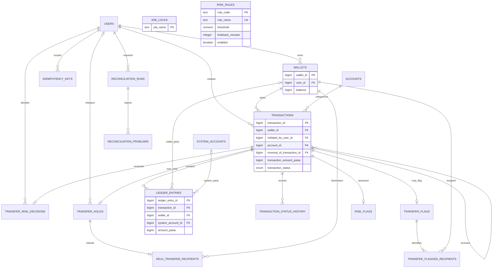

# Schema, nouns and cardinality

The complete executable schema is
[`V1__create_wallet_schema.sql`](../src/main/resources/db/migration/V1__create_wallet_schema.sql).
Flyway creates it from an empty PostgreSQL 17 database and validates its checksum
on every later startup. Seed-scale fixtures are separate from schema migration.
IDs are BIGINT identities; money is signed whole INR paise in BIGINT; aggregates
use PostgreSQL NUMERIC. Event timestamps are TIMESTAMPTZ.

## Noun list

| Noun | Representation and decision |
| --- | --- |
| User | `users`; normalized unique email, name, phone, KYC enum. |
| Wallet | `wallets`; belongs to exactly one user; nonnegative cached balance. |
| Category | `accounts`; one shared catalog, not one table per account type. |
| System account | `system_accounts`; CASH_IN, CASH_OUT and FEE_REVENUE ledger participants, separate from categories. |
| Transfer / transaction | `transactions`; one business header of type TOPUP, TRANSFER, WITHDRAWAL or REVERSAL. |
| Sender / recipient | Wallet roles identified by negative / positive entries; not separate user entities. |
| Ledger entry | `ledger_entries`; exactly one wallet or system account, signed nonzero amount. |
| Status event | `transaction_status_history`; append-only transition audit. |
| Retry / idempotency claim | `idempotency_keys`; per-user UUID, SHA-256 operation/path/body hash, exact response text. |
| Held intent | `transfer_holds` plus `held_transfer_recipients`; immutable recipient amounts without movements or reservations. |
| Risk rule | `risk_rules`; unique code and name, threshold, window and enabled flag. |
| Flag | `transfer_flags` plus `transfer_flagged_recipients`; advisory rule result and recipient evidence. |
| Assessment | `risk_flags`; immutable triggering rule/action, label, explanation and source. |
| Admin decision | `transfer_risk_decisions`; one release/reverse decision with actor, reason and timestamp. |
| Reconciliation job / run / problem | `job_locks`, `reconciliation_runs`, `reconciliation_problems`; coordination, durable execution and findings. |
| Seed batch | `seed_batches`; created only by the fixture script to make a completed bulk seed a no-op on retry. |
| Currency / KYC / status | INR is a single application currency; KYC and transaction status are enums, not independent entities. |

## Cardinality decisions

A user has **0..many wallets**, each owned by exactly one user. Wallet ownership is
not unique, permitting the requested 2,000 wallets for 1,000 users. A transaction
has exactly one initiating wallet, user and category. A wallet has 0..many initiated
transactions and 0..many ledger entries. One transaction has 0..many entries, but
posting requires at least two balanced entries and a positive sum matching its
amount. PENDING/HELD/FAILED intents have no committed movements in the service
protocol. Each entry chooses exactly one party: wallet XOR system account.

A many-to-many wallet/transaction relationship is resolved by ledger entries. A
partial unique index permits at most one entry per wallet (or system party) per
transaction. A transfer has one negative sender and 1..100 distinct positive
recipients in the API; the sender cannot also be a recipient. Multi-recipient
allocation therefore belongs in entries, not a single recipient column.

A transaction has 0..1 hold, with 1..many intended recipients for a held transfer.
The composite `(transaction_id, wallet_id)` primary key prevents duplicate held
recipients. Holds and assessments are one per transaction because the risk engine
short-circuits at the first HOLD and stores one selected advisory result. A hold
may have no approving user until released. A risk decision is optional and unique
per transaction. A transaction may reference one original for reversal; a partial
unique index permits at most one POSTED reversal of an original.

A user has many idempotency keys; `(user_id, key)` is unique. Responses are TEXT,
not JSONB, so exact response serialization is retained. IN_PROGRESS cannot have
response fields; COMPLETED must have both code and body. No in-progress claim is
committed separately. A reconciliation run has 0..many problems; `(run_id,
check_name, entity_id)` is unique. One stable job-lock row coordinates all workers
for the named job, across distinct queued runs.

## ER diagram

Rule codes/names are copied into immutable evidence, not foreign-key linked to
mutable configuration. The job name in runs is also a logical name, not a foreign
key to the coordination row. The XOR participant rule and the partial unique
reversal constraint are SQL constraints that the ER notation cannot express fully.

## Integrity and access paths

Foreign keys protect ownership and party references. Checks reject nonpositive
header amounts, zero entries, invalid participant combinations, malformed response
state, negative wallet caches and invalid reversal/time state. Triggers make
ledger entries and posted terms immutable, reject entries into non-PENDING
transactions, and preserve audit history. Multi-row balance and total checks are
performed by the posting repository inside the service transaction; raw privileged
SQL is not equivalent to that posting protocol. Reconciliation independently checks
the resulting invariants from a consistent snapshot.

Indexes cover wallet ownership, transaction entries, descending statement
`(wallet_id, created_at, ledger_entry_id)`, outgoing time-window statistics,
positive recipient history, user posting history, risk queue dates, and reports.
Statement pagination supports offset for simple access and a wallet-bound cursor
for stable descending traversal. Ledger facts are the authority; cache values
are never repaired automatically by the worker.
